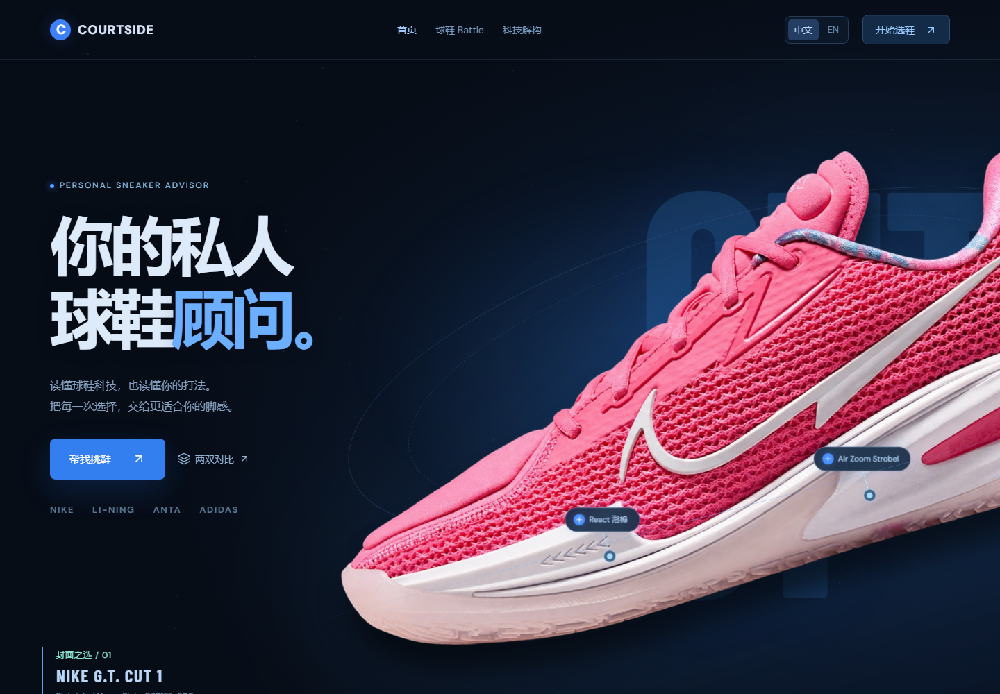

<div align="center">

# COURTSIDE
### Your personal sneaker advisor

**Built around the shoe. Tuned to your game.**

[中文](README.md) · [English](README_EN.md) · [Live demo](https://zichengx576-bot.github.io/courtside/)


</div>

COURTSIDE is a bilingual basketball shoe advisor and technology showcase. Product photography, source-linked specifications, side-by-side comparisons and interactive midsole illustrations turn complex configurations into a clearer shortlist to try on.



## 🏀 Start with your game

| Experience | What you can explore |
| --- | --- |
| **17 shoe profiles** | Specifications, photographs, suggested play styles and sources across Nike/Jordan, Li-Ning, ANTA, adidas and PUMA |
| **Shoe Battle** | Compare two shoes through five radar dimensions, configurations and editorial scores |
| **Personal recommendations** | Screen candidates by weight, play style, court, position and feel preferences, with explanations and unresolved fit questions |
| **15 NBA style templates** | Understand footwear priorities through ball handling, off-ball shooting, physical play and interior playmaking |
| **Technology breakdowns** | Rotate and expand midsoles, select components and inspect their placement, purpose, sources and undisclosed details |
| **Multi-angle photography** | Drag, use arrow keys, play available angles and zoom product photographs |
| **X-dragon Q&A** | Ask about cushioning, support, weight and recommendation evidence, including contextual follow-ups |
| **Two languages and local persistence** | Switch between Chinese and English; save comparisons, player profiles and recent questions in the current browser |

The archive includes WOW 12, Kobe 6 Protro, Sabrina 4, Ja 4, Book 2, Gamma 2, KD19, Air Jordan 41, KAI 3, 808 6 Ultra, Harden Vol.10, Luka 5, LeBron 23, Giannis Freak 8, G.T. Cut 1, MB.06 and Anthony Edwards 2. Series announcements, season positioning and colorway release dates are recorded separately; not every model first launched in the same year.

## 🌐 Live demo and deployment scope

**[Explore GitHub Pages →](https://zichengx576-bot.github.io/courtside/)**

| Feature | This repository's GitHub Pages demo |
| --- | --- |
| Archive, comparisons, recommendations, photos, 3D, languages and local Q&A | Available |
| Saved browser preferences, profiles and questions | Available; clearing site data resets them |
| Site-wide visitor totals, shared community posts and author deletion | Unavailable without a server and storage; the interface reports an unavailable state |

[GitHub Pages](https://docs.github.com/en/pages/getting-started-with-github-pages/what-is-github-pages) hosts static files and cannot execute the backend in `app/api/` or `server/`. These sources remain in the repository, but the demo does not invent visitor totals, simulate community posts or automatically connect to another platform's backend. The author manages the existing full-site deployment separately.

## 🛠️ Stack

The frontend uses React, Vite, Three.js, Motion, Recharts and Lucide, with CSS and the project's existing Tailwind tooling. Next.js/vinext, Cloudflare D1 routes and the existing storage adapter are retained for maintenance of the full application. Pages uses a separate SPA build path.

## 🚀 Run locally

Use **Node.js 22.13 or newer** and npm.

```bash
git clone https://github.com/zichengx576-bot/courtside.git
cd courtside
npm ci
npx vite --config vite.spa.config.mjs --host 127.0.0.1
```

Open the local URL shown in the terminal. This previews the frontend without starting the visitor or community APIs. X-dragon queries a local knowledge archive; it does not call an external AI model and requires no AI API key.

### Update Pages

```bash
node scripts/build-pages.mjs
git add src public pages scripts README.md README_EN.md
git commit -m "Update Courtside website"
git push origin main
```

The build script updates only the generated `pages/` directory, adapts public-image paths in the output for `/courtside/`, and adds `.nojekyll` and `404.html`. Path adaptation does not modify the original HTML/CSS/JS. GitHub Actions publishes the committed `pages/` output without installing application dependencies in the cloud. Rebuild and commit the output whenever the source changes.

## 🗂️ Repository map

```text
src/                  React UI, archive, recommendations and Q&A
public/               Shoe and player photography, artwork and provenance
app/api/ + server/    Full-application backend sources; not executed by Pages
scripts/              Checks, translation tools and Pages build
pages/                Built static site for GitHub Pages
docs/                 Recommendation evidence and asset-rights notes
.github/workflows/    GitHub Pages deployment
```

## 🔎 Evidence and visualization limits

- Radar and matching scores are screening suggestions based on public specifications and editorial judgment, without standardized testing by this project. Lightweight scores are not grams. Recorded height, foot shape and arch information do not constitute validated performance predictions.
- Some profiles cite independent tests or wear reviews. Check the exact version, size and surface separately. Unknown values and conflicting sources remain explicit rather than being filled with invented specifications.
- Midsole models are explanatory reconstructions, not 1:1 geometry; complete dimensional CAD is unavailable. Multi-angle photos are not continuous 360-degree scans.
- X-dragon answers come from local records and rules, not a live language model, price feed or purchase guarantee.
- Recommendations narrow the try-on shortlist. Sizing, containment and feel still require an in-person fit check.

## 🤝 Contribute

Use [Issues](https://github.com/zichengx576-bot/courtside/issues) for interface problems, specification corrections and shoe requests. Corrections should include original sources, the exact version and colorway. Interface reports should include the device, browser and steps to reproduce. Confirm permission and preserve attribution before contributing images.

## 📄 License and assets

No open-source license has been assigned to the original application code. Public availability does not grant unrestricted redistribution or commercial rights. Brand imagery and player photographs retain their original rights and individual licenses; third-party code retains its existing licenses. See [Asset and code rights](docs/ASSET-RIGHTS.md), [product-image sources](public/shoes/sources.json) and [player-photo license records](public/players/sources-verified.json).
